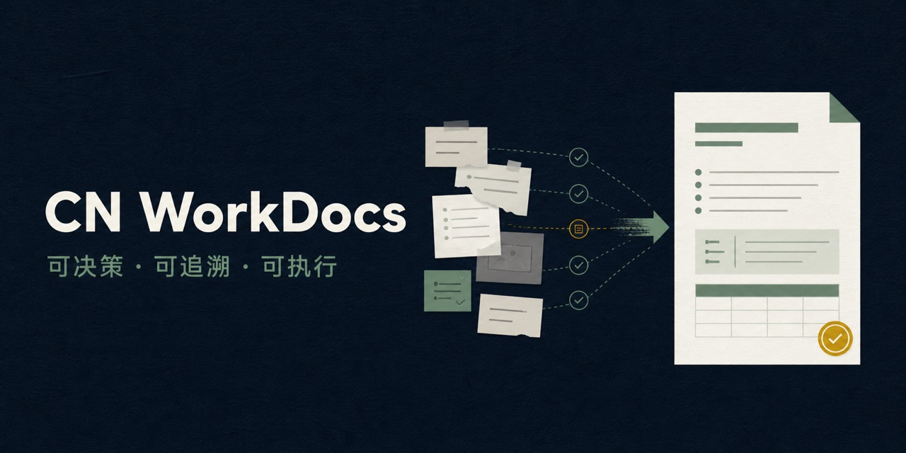

# CN WorkDocs

> **把零散材料变成可决策、可追溯、可执行的中文工作文档。**
> Turn scattered evidence into decision-ready Chinese work documents.

[](https://skills.sh/zhuyep/cn-workdocs)
[](https://github.com/zhuyep/cn-workdocs/actions/workflows/validate.yml)
[](https://github.com/zhuyep/cn-workdocs/releases)
[](LICENSE)

`cn-workdocs` 是一个面向企业、事业单位、学校、医院、研究机构和项目团队的中文工作文档 Agent Skill，聚焦调研分析、方案计划、工作总结、会议纪要和领导讲话五类场景。它不靠堆砌“高度、力度、深度”，而是控制事实边界、建立证据链、压缩空话，并把判断落实到行动与交付物：少空话、不编造、可核验、能交付。

`cn-workdocs` is an Agent Skill for Chinese enterprise and institutional writing. It helps an AI agent turn incomplete notes and source material into concise, evidence-aware reports, proposals, summaries, meeting minutes, and leadership speeches—without inventing facts or hiding uncertainty behind polished language.

## 30-second example / 30 秒示例

| Rough note / 原始记录 | CN WorkDocs result / 整理结果 |
| --- | --- |
| `先找一个部门试三个月，年底前看要不要推广。` | **建议判断**：先小范围试点，不直接全面推广。**已知时间**：一个部门、三个月，并以年底前形成是否推广的判断为目标。**缺口**：责任人、预算和效果基线标为 `[待补]`。**建议补充**：把越权访问或结果不可追溯列为试点停止条件。 |

It does not merely make the sentence sound formal. It decides what is known, what is only asserted, what action follows, and what must remain unresolved. See the complete [pilot proposal](examples/pilot-proposal.md).

它不是把句子换得更“正式”，而是分清已知事实、来源陈述、行动结论和必须保留的缺口。查看完整[试点方案示例](examples/pilot-proposal.md)。

The Chinese example preserves the requested scope and timing. The bounded-pilot judgment and stop conditions are explicitly recommendations, while missing owners, budget, and baselines remain unresolved.

### Catch unsupported claims / 抓住无依据结论

| Draft sentence / 草稿原句 | Audit finding / 审查结果 |
| --- | --- |
| `本季度一次解决率提升 40%，按《知识管理办法》本月底必须全员上线。` | **无依据业绩**：材料里没有 40% 的口径、基期或来源，不能写成已核结果，应标 `[待核]` 或删掉数字。**编造政策**：未提供名为《知识管理办法》的文件，不得写成强制依据；全员上线期限改为建议并标 `[待补]`。审查只指出问题，不擅自改写成定稿。 |

See the complete [audit example](examples/audit-unsupported-claims.md).  
查看完整[打假审查示例](examples/audit-unsupported-claims.md)。



## Why this exists / 为什么做它

普通提示词很容易生成“句句正确、没有一句能负责”的材料：事实与判断混在一起，缺失信息被自动补齐，建议只有方向没有责任人，篇幅很长但无法支持决策。

CN WorkDocs 把写作过程变成一条可检查的流水线：

```text
原始材料 → 事实/推断/建议/未知分层 → 核心判断 → 行动型提纲
        → 正文起草 → 反方审查 → 格式与交付质检
```

This is not another collection of ceremonial templates. It gives the agent an operating method: classify evidence, expose unknowns, write the controlling judgment, structure around the reader's next action, run an adversarial revision, and verify the delivered artifact.

### What it is not / 它不是什么

| Category / 类型 | Primary concern / 主要解决的问题 |
| --- | --- |
| Official-document writer / 公文写作工具 | Statutory document types, formal wording, and administrative relationships / 法定文种、规范措辞与行文关系 |
| Document formatter / 排版工具 | Fonts, margins, headers, page numbers, and a named layout standard / 字体、页边距、版记、页码和指定格式标准 |
| **CN WorkDocs** | Evidence boundaries, decision logic, executable actions, adversarial revision, and delivery QA / 事实边界、决策逻辑、行动落地、反方审查与交付质检 |

CN WorkDocs can work alongside writing and formatting tools, but it deliberately does not pretend to replace their specialized rules.

## What it handles / 适用材料

- 调研报告、分析报告 / research and analysis reports
- 建设方案、实施方案 / proposals and implementation plans
- 工作报告、总结、汇报材料 / work reports and summaries
- 会议纪要 / meeting minutes
- 领导讲话、发言稿 / leadership speeches
- 已有材料的压缩、改写与独立审查 / revision, compression, and independent audit

It is intentionally **not** a legal adviser or a GB/T 9704 formatting guarantee. Mandatory standards require an authoritative template and human verification.

## Four design choices / 四个核心机制

1. **证据控制**：把来源陈述、权威记录、已核事实、推断、建议和未知分开，重要结论必须有依据。
2. **缺口显式化**：缺内容用 `[待补]`，已有但未核验用 `[待核]`，绝不悄悄编造。
3. **行动密度**：把“加强协同、持续推进”还原为责任主体、动作、对象、时间、产出和验收条件。
4. **交付质检**：正文定稿后再做排版，并检查分页、表格、字体替代、引用、时长和隐藏信息。

## Install / 安装

已验证的 Codex 一键安装：

```bash
npx skills add zhuyep/cn-workdocs --skill cn-workdocs -g -a codex -y
```

Verified one-command installation for Codex. The same open CLI supports other agents; change the `-a` target when needed. Browse the indexed skill on [skills.sh](https://skills.sh/zhuyep/cn-workdocs/cn-workdocs).

Confirm that the public repository is discoverable before installing / 安装前可先确认公开仓库能被识别：

```bash
npx skills add zhuyep/cn-workdocs --list
```

如果不想使用安装器，也可以手动克隆并复制 Skill：

Clone the repository and copy the skill into your agent's skill directory:

```bash
git clone https://github.com/zhuyep/cn-workdocs.git
mkdir -p "${CODEX_HOME:-$HOME/.codex}/skills"
cp -R cn-workdocs/skills/cn-workdocs "${CODEX_HOME:-$HOME/.codex}/skills/"
```

For project-local use, copy `skills/cn-workdocs` into the skill directory supported by your coding agent. The repository follows the standard `SKILL.md` layout and includes optional Codex interface metadata.

如需项目内共享，可把 `skills/cn-workdocs` 放入所用智能体支持的项目级 Skill 目录。本仓库采用标准 `SKILL.md` 结构，并提供可选的 Codex 界面元数据。

## Try it / 立即试用

```text
Use $cn-workdocs to turn these rough notes into a 1,500-word Chinese
implementation proposal for management. Separate verified facts from
assumptions, mark missing inputs as [待补] and unverified claims as [待核], and end with owners,
milestones, acceptance criteria, risks, and stop conditions.
```

```text
使用 $cn-workdocs，把下面的会议速记整理成正式纪要。严格区分已经形成的决定、
待办事项和仍有分歧的问题；每项任务写清责任人、完成时间和交付物，不要补造共识。
```

## Example / 示例

- [Pilot proposal / 试点方案](examples/pilot-proposal.md): turns six rough notes into a bounded decision without inventing budget, performance, or policy claims.
- [Meeting minutes / 会议纪要](examples/meeting-minutes.md): separates decisions, tasks, proposals, and unresolved disagreements without manufacturing consensus.
- [Audit unsupported claims / 打假审查](examples/audit-unsupported-claims.md): catches an unsourced 40% performance claim and an invented policy citation, and stops short of silently rewriting the draft.

两个示例都是虚构材料，但刻意保留真实工作中最容易出错的信息缺口、未核陈述和未形成共识。

## Repository layout / 仓库结构

```text
skills/cn-workdocs/
├── SKILL.md
├── agents/openai.yaml
└── references/
    ├── evidence-control.md
    ├── document-types.md
    ├── revision-and-tone.md
    └── delivery-and-qa.md
examples/
scripts/validate_repo.py
tests/
```

## Compatibility / 兼容性

The skill is plain Markdown and has no model API dependency. It is designed for Codex and can be adapted to other coding agents that support folder-based Agent Skills. Tool names and installation paths may differ by product.

Skill 本身是纯 Markdown，不调用模型 API。它主要面向 Codex，也可以适配支持目录式 Agent Skill 的其他编程智能体；不同产品的工具名称和安装路径可能不同。

## Trust boundary / 信任边界

- The installed skill bundle contains Markdown instructions, references, and optional interface metadata—no executable script or bundled API client. The skill package cannot send data by itself; the agent using it may still invoke tools allowed by that product and the user's task.
- Skill 安装包只包含 Markdown 指令、参考资料和可选界面元数据；不含可执行脚本或 API 客户端，安装包本身不会发送数据。实际使用时，智能体仍可能按用户任务调用该产品允许的工具。
- Repository CI checks required files, metadata, YAML, local Markdown links, and regression markers. Maintainers also run platform validation and an installation smoke test before releases. / 仓库 CI 检查必需文件、元数据、YAML、本地 Markdown 链接和回归标记；维护者在发布前另行运行平台校验与安装冒烟测试。

## FAQ / 常见问题

**它是公文生成器吗？ / Is this an official-document generator?**

不是。它聚焦事实边界、证据链、决策逻辑和执行条件；法定文种、必选版式和 GB/T 9704 合规仍需专门工具、权威模板和人工复核。

No. It focuses on evidence boundaries, decision logic, and executable action. Statutory document selection and mandatory layout compliance still require specialist tools, authoritative templates, and human review.

**需要 API Key 吗？ / Does it need an API key?**

不需要。Skill 本身是纯文本工作流；你所使用的智能体产品可能有自己的账号或计费要求。

No. The skill is a plain-text workflow, although the agent product you use may have its own account or billing requirements.

**能直接生成 Word/PDF 吗？ / Can it generate Word or PDF files?**

它可以指导支持文档工具的智能体完成格式化交付和逐页质检，但不内置文档转换引擎。没有相应工具时，它会返回结构化文本。

It can guide an agent with document tools through formatted delivery and page-by-page QA, but it does not bundle a conversion engine. Without those tools, it returns structured text.

## Contributing / 参与贡献

Real failure cases are more valuable than more slogans. If the skill produces an unsupported claim, vague action, damaged document structure, or unnatural Chinese expression, please open an issue with a sanitized input and the problematic output.

真实失败案例比继续增加口号更有价值。如果 Skill 产生无依据结论、模糊任务、错误文档结构或不自然中文，欢迎提交脱敏后的输入与问题输出。参见 [CONTRIBUTING.md](CONTRIBUTING.md)。

## License / 许可证

[MIT](LICENSE) © Zhuy
